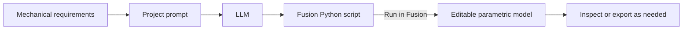

# ⚡ AI-to-CAD: Parametric B-Rep Generation with Fusion 360

[](./LICENSE)
[](https://www.autodesk.com/products/fusion-360)
[](https://www.python.org/)
[](./tools/)

> A prompt-driven workflow for translating mechanical requirements into editable Autodesk Fusion models using the native Python API. This repository brings together design prompts, Fusion scripts, example artifacts, and tooling for working with Fusion through MCP.

## Why AI-to-CAD?

Many generative 3D workflows produce triangulated meshes such as `.stl` or `.obj`. Meshes can be useful for visualization and printing, but they are generally less convenient to dimension, constrain, and revise than native CAD models.

This project focuses on generating **parametric B-Rep models** in Fusion:

- **Native CAD features:** Build models from Fusion sketches and modeling features rather than treating the result only as a triangle mesh.
- **Editable designs:** Keep the design in Fusion so you can inspect and revise its geometry and feature history.
- **Prompt-guided workflow:** Use the repository's [system prompt](./prompts/system_prompt.md) and project-specific design prompts with runnable Fusion Python scripts.
- **MCP tooling:** [`tools/fusion-mcp-studio`](./tools/fusion-mcp-studio/) provides a browser UI for connecting to Fusion's MCP server, editing and running scripts, discovering local scripts, and viewing screenshots. See [Tools](./tools/README.md) for setup.

## Workflow



1. **Specify** the requirements, interfaces, dimensions, and constraints in a project prompt.
2. **Generate or adapt** a script by saying using Fusion 360 python scripts.
3. **Run** the script in Fusion 360's Scripts and Add-Ins environment, or use the MCP tooling described in [`tools/README.md`](./tools/README.md).
4. **Review and iterate** on the resulting design in Fusion.
5. **Export the one-shot prompt**: Once the design is working, distill the conversation into a reusable prompt using the [Fusion 360 export prompt](./prompts/export_one_shot_prompt.md) as guidance.

## Projects

| Project | Prompt | Fusion script | Included artifact / notes |
| --- | --- | --- | --- |
| **iPhone bed mount** | [Prompt](./projects/iphone-automation-mount/iphone-bed-mount/iphone-bed-mount_PROMPT.md) | [Script](./projects/iphone-automation-mount/iphone-bed-mount/iphone-bed-mount.py) | Example STL artifact |
| **Prusa Mini stylus holder — standard** | [Prompt](./projects/iphone-automation-mount/prusa-mini-stylus-holder/stylus_holder_standard_PROMPT.md) | [Script](./projects/iphone-automation-mount/prusa-mini-stylus-holder/stylus_holder_standard.py) | Standard variant |
| **Prusa Mini stylus holder — 65 mm offset** | [Prompt](./projects/iphone-automation-mount/prusa-mini-stylus-holder/stylus_holder_offset_65mm_PROMPT.md) | [Script](./projects/iphone-automation-mount/prusa-mini-stylus-holder/stylus_holder_offset_65mm.py) | 65 mm offset variant |
| **iPhone automation mount** | [Project overview](./projects/iphone-automation-mount/README.md) | — | Project documentation |

See [`projects/`](./projects/) for project organization and notes.

## Quickstart: run a Fusion script

### Requirements

- Autodesk Fusion 360
- A project script from this repository

### Run

1. Open Fusion 360.
2. Press **Shift + S** to open **Scripts and Add-Ins**.
3. Add or select the folder containing the script you want to run, for example `projects/iphone-automation-mount/iphone-bed-mount/`.
4. Select the script and click **Run**.

These scripts use Fusion's `adsk` API and must run inside Fusion's scripting environment; they are not standalone system-Python programs.

## Fusion API notes

- Fusion's internal database unit for lengths is centimeters. For length values, `ValueInput.createByReal(10)` represents 10 cm—not 10 mm. Use `ValueInput.createByString("25 mm")` when specifying a value in millimeters.
- Avoid relying on arbitrary profile indices when selecting sketch regions. Where practical, identify the intended profile from its geometry or location.
- Make script errors visible during development by handling exceptions and reporting useful traceback information in Fusion's UI or log.

For broader prompt and API guidance, see [`prompts/export_one_shot_prompt.md`](./prompts/export_one_shot_prompt.md).

## Fusion MCP Studio

The [`tools/fusion-mcp-studio`](./tools/fusion-mcp-studio/) directory contains a browser UI for working with Fusion's MCP server. The repository's [tools guide](./tools/README.md) documents the requirements and usage.

## Repository layout

```text
ai-to-cad-project/
├── projects/
│   ├── README.md
│   ├── iphone-automation-mount/
│   │   ├── README.md
│   │   ├── iphone-bed-mount/
│   │   │   ├── iphone-bed-mount_PROMPT.md
│   │   │   ├── iphone-bed-mount.py
│   │   │   └── iphone-bed-mount.stl
│   │   └── prusa-mini-stylus-holder/
│   │       ├── stylus_holder_standard_PROMPT.md
│   │       ├── stylus_holder_standard.py
│   │       ├── stylus_holder_offset_65mm_PROMPT.md
│   │       └── stylus_holder_offset_65mm.py
│   └── ...
├── prompts/
│   └── export_one_shot_prompt.md
├── tools/
│   ├── README.md
│   └── fusion-mcp-studio/
├── LICENSE
└── README.md
```

## Contributing

Contributions of new mechanical designs, prompt templates, and tooling improvements are welcome. For a new CAD project, use a dedicated folder under `projects/` and include the design prompt and runnable Fusion script.

## License

This project is distributed under the terms of the [MIT License](./LICENSE).
