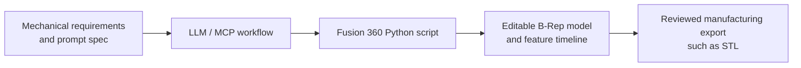

# ⚡ AI-to-CAD: Parametric B-Rep Generation with Fusion 360

[](https://opensource.org/licenses/MIT)
[](https://www.autodesk.com/products/fusion-360/)
[](https://www.python.org/)
[](https://modelcontextprotocol.io/)

> A prompt-driven workflow for turning mechanical requirements into editable Autodesk Fusion 360 models using Python API scripts. The repository includes prompt specifications, runnable scripts, and an example STL export.

---

## 🎯 Overview

Many AI-to-3D workflows produce polygon meshes that are difficult to edit as mechanical designs. This project focuses on generating native Fusion 360 geometry with sketches and an editable feature timeline, while keeping design requirements and generation guidance in version-controlled Markdown files.

The workflow connects four stages:

1. **Specify:** Describe dimensions, clearances, and design constraints in a module's `_PROMPT.md` file.
2. **Generate or adapt:** Use the prompt with an LLM or MCP-enabled workflow to create or modify a Fusion 360 Python API script.
3. **Build:** Run the script in Fusion 360 to create a native model.
4. **Export:** Review the model and export a mesh or CAD file as needed. An example STL is included for the iPhone bed mount.



## 📂 Repository layout

```text
ai-to-cad-project/
├── prompts/
│   └── fusion360_system_prompt.md      # General Fusion 360 code-generation guidance
├── tools/
│   ├── README.md                      # Tool catalog and conventions
│   └── iphone-automation-mount/
│       ├── iphone-bed-mount/
│       │   ├── iphone-bed-mount_PROMPT.md
│       │   ├── iphone-bed-mount.py
│       │   └── iphone-bed-mount.stl   # Example mesh export
│       └── prusa-mini-stylus-holder/
│           ├── stylus_holder_standard_PROMPT.md
│           ├── stylus_holder_standard.py
│           ├── stylus_holder_offset_65mm_PROMPT.md
│           └── stylus_holder_offset_65mm.py
├── LICENSE
└── README.md
```

## 🧩 Modules

| Module | Prompt specification | Fusion 360 script | Available output / status |
| :--- | :--- | :--- | :--- |
| **iPhone bed mount** | [`iphone-bed-mount_PROMPT.md`](./tools/iphone-automation-mount/iphone-bed-mount/iphone-bed-mount_PROMPT.md) | [`iphone-bed-mount.py`](./tools/iphone-automation-mount/iphone-bed-mount/iphone-bed-mount.py) | [Example STL](./tools/iphone-automation-mount/iphone-bed-mount/iphone-bed-mount.stl); implemented |
| **Prusa Mini stylus holder — standard** | [`stylus_holder_standard_PROMPT.md`](./tools/iphone-automation-mount/prusa-mini-stylus-holder/stylus_holder_standard_PROMPT.md) | [`stylus_holder_standard.py`](./tools/iphone-automation-mount/prusa-mini-stylus-holder/stylus_holder_standard.py) | Script and prompt included |
| **Prusa Mini stylus holder — 65 mm offset** | [`stylus_holder_offset_65mm_PROMPT.md`](./tools/iphone-automation-mount/prusa-mini-stylus-holder/stylus_holder_offset_65mm_PROMPT.md) | [`stylus_holder_offset_65mm.py`](./tools/iphone-automation-mount/prusa-mini-stylus-holder/stylus_holder_offset_65mm.py) | Script and prompt included |
| **Text-to-screw generator** | — | — | Proposed; generator files are not currently included |

See the [tools catalog](./tools/README.md) for additional module notes.

## 📝 Working with prompt specifications

The `_PROMPT.md` files capture design intent and constraints alongside the scripts they describe. To adapt a design:

1. Open the relevant module prompt and review its dimensions and assumptions.
2. Update the requirements for your intended device, printer, or hardware.
3. Use the prompt with your LLM or MCP workflow to generate or revise a Fusion 360 script.
4. Review the generated code and run it in Fusion 360.
5. Inspect the resulting geometry and export the formats you need.

For general API and code-generation guidance, see [`prompts/fusion360_system_prompt.md`](./prompts/fusion360_system_prompt.md).

## 📐 Fusion 360 and manufacturing guidelines

- **Convert units explicitly.** Fusion 360's API uses centimeters for its internal length units. Convert millimeters rather than passing millimeter values directly:

  ```python
  MM = 0.1  # 1 mm = 0.1 cm
  width = 65.0 * MM
  thickness = 8.5 * MM
  ```

- **Prefer robust geometry references.** Avoid depending on transient edge or face array indices where possible. Use parameterized sketches and stable design references.
- **Keep feature order deliberate.** Build the main body first, add joined features next, then create cuts and clearances.
- **Treat fit values as design inputs.** Clearances depend on the printer, material, orientation, and mating part; verify them with test prints rather than assuming a universal tolerance.
- **Review before fabrication.** Confirm dimensions, fit, model integrity, and printer compatibility. Example meshes and scripts are not engineering certification.

## 🚀 Quickstart

### Run or edit a model in Fusion 360

1. Clone the repository:

   ```bash
   git clone https://github.com/dty717/ai-to-cad-project.git
   ```

2. Open Autodesk Fusion 360 and press <kbd>Shift</kbd> + <kbd>S</kbd> to open **Scripts and Add-Ins**.
3. Add or select the folder containing the script you want to run, for example `tools/iphone-automation-mount/iphone-bed-mount/`.
4. Select the Python script and click **Run**.
5. Inspect the generated model, make any required changes, and export it from Fusion 360.

The scripts use Fusion 360's `adsk` API and must run in Fusion 360's scripting environment; they are not standalone system-Python programs.

### Print the included example mesh

Download the [iPhone bed mount STL](./tools/iphone-automation-mount/iphone-bed-mount/iphone-bed-mount.stl) into your slicer. Check scale, orientation, clearances, and printer-bed compatibility before printing.

## 📄 License

This project is distributed under the [MIT License](./LICENSE).
